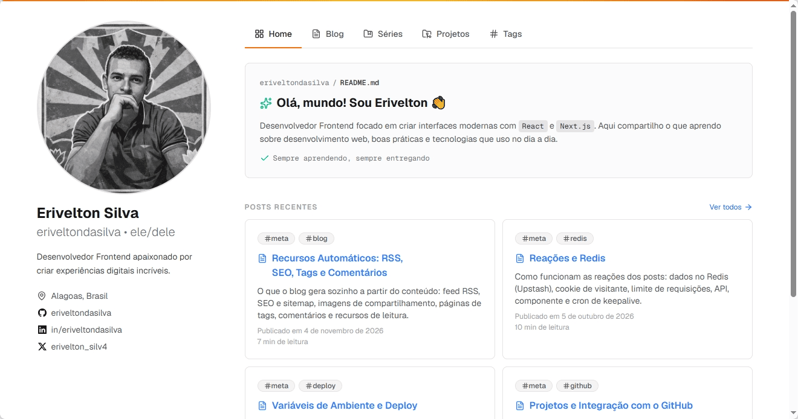

# Erivelton's Portfolio

Personal portfolio and blog built with Next.js and MDX.

**Live:** [erivelton.vercel.app](https://erivelton.vercel.app) · [Português (BR)](./README.pt.md)



## About

A personal site with a blog written in MDX, post series, and a project list pulled straight from GitHub. All content lives in the repository as files and is validated at build time, so invalid content never reaches production.

## Features

- **MDX blog:** post metadata in `meta.yml` validated with Zod, plus tags, authors, series and archived posts.
- **Projects from GitHub:** public repositories with the `portfolio` topic become projects. The `featured` topic highlights one and `wip` marks it as in progress.
- **Reactions and comments:** anonymous reactions (no login, a single visitor cookie) backed by Upstash Redis with rate limiting, and comments via Giscus.
- **Automatic extras:** RSS feed, sitemap, Open Graph images, JSON-LD, table of contents and reading time.
- **Build-time validation:** broken metadata, images or references fail the build.

## Tech stack

Next.js 16 · React 19 · TypeScript · Tailwind CSS 4 · shadcn/ui · MDX · Zod · Upstash Redis · Giscus · Bun · Vercel

## Getting started

Requires [Bun](https://bun.sh) 1.x. The scripts and the build use Bun APIs, so Node alone is not enough.

```bash
bun install
cp .env.example .env.local
bun run build:indexes
bun run dev
```

Then open <http://localhost:3000>.

The dev server does not regenerate the content indexes: run `bun run build:blog` after changing a `meta.yml`, `authors.yml` or `series.yml`.

### Environment variables

| Variable                                             | Required      | Purpose                                                                                                     |
| ---------------------------------------------------- | ------------- | ----------------------------------------------------------------------------------------------------------- |
| `UPSTASH_REDIS_REST_URL`, `UPSTASH_REDIS_REST_TOKEN` | For reactions | Upstash Redis credentials. The rest of the site does not use Redis.                                         |
| `RATE_LIMIT_SECRET`                                  | For reactions | Key used to hash IP addresses before they reach the rate limiter. Generate one with `openssl rand -hex 32`. |
| `CRON_SECRET`                                        | In production | Authorizes the `/api/keepalive` cron call.                                                                  |
| `NEXT_PUBLIC_SITE_URL`                               | In production | Public site URL (sitemap, RSS, Open Graph). On Vercel it falls back to the production domain when missing.  |
| `GITHUB_TOKEN`                                       | No            | Raises the GitHub API rate limit when generating the project list.                                          |

## Writing a post

1. Run `bun run new-post`. It asks for the metadata and creates `content/posts/<slug>/` with `meta.yml`, `index.mdx` and an `images/` folder, as a draft.
2. Write the post in `index.mdx`. Images go in `images/` (lowercase, hyphenated names) and an optional cover is `cover.<ext>` in the post folder.
3. Set `status: published` and update `publishedAt` in `meta.yml`. Run `bun run build:blog` to see it in the dev server.

A post can be `draft` (hidden), `published`, or `archived` (reachable by URL, but not listed and closed to new reactions).

## Scripts

| Command                            | What it does                                                  |
| ---------------------------------- | ------------------------------------------------------------- |
| `bun run dev`                      | Starts the dev server.                                        |
| `bun run build`                    | Generates the blog and project indexes, then builds the site. |
| `bun run build:indexes`            | Generates every index and the JSON Schemas.                   |
| `bun run build:blog`               | Regenerates the posts, authors and series indexes.            |
| `bun run build:projects`           | Fetches the projects from GitHub.                             |
| `bun run new-post`                 | Scaffolds a new post.                                         |
| `bun run fix`                      | Type-checks, lints and formats, fixing what it can.           |
| `bun run lint:check` / `fmt:check` | Lint and format checks that do not write to disk.             |
| `bun run knip`                     | Finds unused files, exports and dependencies.                 |

## Project structure

```text
content/
  authors.yml            # authors
  series.yml             # post series
  posts/<slug>/          # meta.yml, index.mdx, cover.<ext>, images/
scripts/                 # index and schema generators, new-post
src/
  app/                   # routes (blog, series, tags, projects, API)
  components/            # UI and MDX components
  lib/                   # blog, reactions, Open Graph and shared logic
generated/               # indexes and JSON Schemas, produced by the scripts
```

## Deployment

The site is deployed on Vercel. `vercel.json` selects the Bun runtime and schedules a cron job twice a week on `/api/keepalive`, which touches Redis so the database does not go idle. Set the environment variables above in the Vercel project settings.

## Using it as a base

To adapt the project, update `content/authors.yml` and the values in `src/lib/constants.ts` (site name, primary author, repository and Giscus IDs). The project list is read from the GitHub account in the primary author's `socials.github`.

## Documentation

The complete documentation is the **Manual do Blog** series (in Portuguese), published on the site: [erivelton.vercel.app/series/manual-do-blog](https://erivelton.vercel.app/series/manual-do-blog). It covers content structure, MDX components, GitHub projects, environment variables and deploy, reactions with Redis, and the automatic features.

## License

[MIT](./LICENSE)
