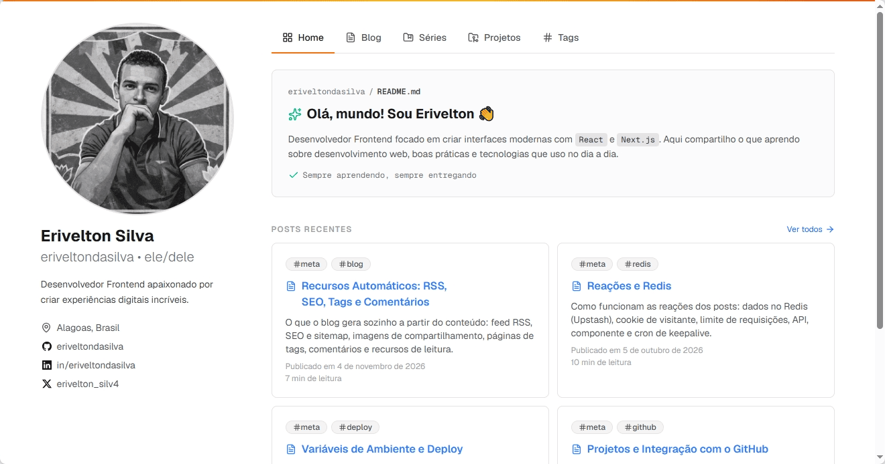

# Erivelton's Portfolio

Portfólio pessoal com blog, feito com Next.js e MDX.

**No ar:** [erivelton.vercel.app](https://erivelton.vercel.app) · [English](./README.md)



## Sobre

Um site pessoal com blog escrito em MDX, séries de posts e uma lista de projetos buscada direto no GitHub. Todo o conteúdo vive no repositório como arquivos e é validado no build, então conteúdo inválido nunca chega à produção.

## Recursos

- **Blog em MDX:** metadados do post em `meta.yml` validados com Zod, além de tags, autores, séries e posts arquivados.
- **Projetos do GitHub:** repositórios públicos com o topic `portfolio` viram projetos. O topic `featured` dá destaque e `wip` marca como em progresso.
- **Reações e comentários:** reações anônimas (sem login, com um único cookie de visitante) usando Upstash Redis com limite de requisições, e comentários via Giscus.
- **Extras automáticos:** feed RSS, sitemap, imagens Open Graph, JSON-LD, índice do post e tempo de leitura.
- **Validação no build:** metadados, imagens ou referências quebradas fazem o build falhar.

## Stack

Next.js 16 · React 19 · TypeScript · Tailwind CSS 4 · shadcn/ui · MDX · Zod · Upstash Redis · Giscus · Bun · Vercel

## Como rodar

Requer o [Bun](https://bun.sh) 1.x. Os scripts e o build usam APIs do Bun, então só o Node não basta.

```bash
bun install
cp .env.example .env.local
bun run generate
bun run dev
```

Depois abra <http://localhost:3000>.

O servidor de desenvolvimento não regenera os índices de conteúdo: rode `bun run generate:blog` depois de alterar um `meta.yml`, `authors.yml` ou `series.yml`.

### Variáveis de ambiente

| Variável                                             | Obrigatória     | Para quê                                                                                                   |
| ---------------------------------------------------- | --------------- | ---------------------------------------------------------------------------------------------------------- |
| `UPSTASH_REDIS_REST_URL`, `UPSTASH_REDIS_REST_TOKEN` | Para as reações | Credenciais do Upstash Redis. O resto do site não usa Redis.                                               |
| `RATE_LIMIT_SECRET`                                  | Para as reações | Chave usada para gerar o hash dos IPs antes de chegarem ao limitador. Gere uma com `openssl rand -hex 32`. |
| `CRON_SECRET`                                        | Em produção     | Autoriza a chamada do cron em `/api/keepalive`.                                                            |
| `SITE_URL`                                           | Em produção     | URL pública do site (sitemap, RSS, Open Graph). Na Vercel, se faltar, usa o domínio de produção.           |
| `GITHUB_TOKEN`                                       | Não             | Aumenta o limite de requisições da API do GitHub ao gerar a lista de projetos.                             |

## Escrevendo um post

1. Rode `bun run new-post`. O script pergunta os metadados e cria `content/posts/<slug>/` com `meta.yml`, `index.mdx` e a pasta `images/`, como rascunho.
2. Escreva o post em `index.mdx`. As imagens ficam em `images/` (nomes em minúsculas, com hífen) e a capa opcional é `cover.<ext>` na pasta do post.
3. Defina `status: published` e atualize `publishedAt` no `meta.yml`. Rode `bun run generate:blog` para ver no servidor de desenvolvimento.

Um post pode ser `draft` (oculto), `published` ou `archived` (acessível pela URL, mas fora das listagens e fechado para novas reações).

## Scripts

| Comando                            | O que faz                                                            |
| ---------------------------------- | -------------------------------------------------------------------- |
| `bun run dev`                      | Inicia o servidor de desenvolvimento.                                |
| `bun run build`                    | Gera os índices do blog e dos projetos e depois faz o build do site. |
| `bun run generate`                 | Gera todos os índices e os JSON Schemas.                             |
| `bun run generate:blog`            | Regenera os índices de posts, autores e séries.                      |
| `bun run generate:projects`        | Busca os projetos no GitHub.                                         |
| `bun run new-post`                 | Cria a estrutura de um post novo.                                    |
| `bun run fix`                      | Aplica lint e formata, corrigindo o que for possível.                |
| `bun run check`                    | Checa tipos, lint e formatação sem escrever em disco.                |
| `bun run lint:check` / `fmt:check` | Verificações de lint e formatação que não escrevem em disco.         |
| `bun run knip`                     | Encontra arquivos, exports e dependências sem uso.                   |

## Estrutura do projeto

```text
content/
  authors.yml            # autores
  series.yml             # séries de posts
  posts/<slug>/          # meta.yml, index.mdx, cover.<ext>, images/
scripts/                 # geradores de índices e schemas, new-post
src/
  app/                   # rotas (blog, séries, tags, projetos, API)
  components/            # UI e componentes MDX
  lib/                   # blog, reações, Open Graph e lógica compartilhada
generated/               # índices e JSON Schemas, produzidos pelos scripts
```

## Deploy

O site roda na Vercel. O `vercel.json` define o runtime Bun e agenda um cron duas vezes por semana em `/api/keepalive`, que acessa o Redis para o banco não ficar ocioso. Configure as variáveis de ambiente acima nas configurações do projeto na Vercel.

## Usando como base

Para adaptar o projeto, atualize o `content/authors.yml` e os valores em `src/lib/constants.ts` (nome do site, autor principal, repositório e IDs do Giscus). A lista de projetos vem da conta do GitHub em `socials.github` do autor principal.

## Documentação

A documentação completa é a série **Manual do Blog**, publicada no site: [erivelton.vercel.app/series/manual-do-blog](https://erivelton.vercel.app/series/manual-do-blog). Ela cobre a estrutura de conteúdo, os componentes MDX, os projetos do GitHub, as variáveis de ambiente e o deploy, as reações com Redis e os recursos automáticos.

## Licença

[MIT](./LICENSE)
